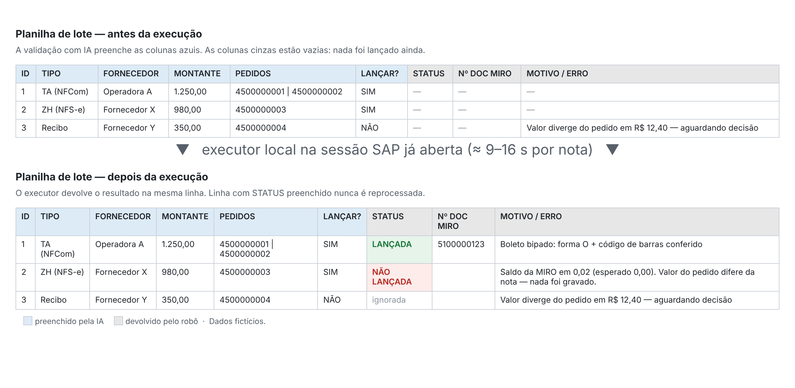
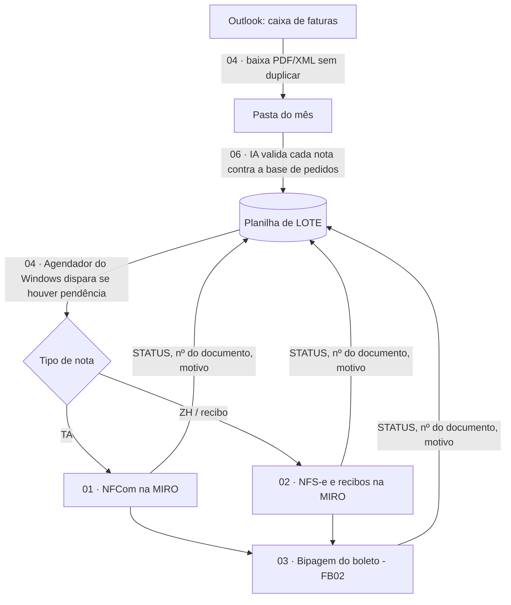

# Automação de Contas a Pagar no SAP com IA

[](https://github.com/SEU-USUARIO/NOME-DO-REPO/actions/workflows/ci.yml)


Este portfólio reúne automações que construí num estágio na área financeira, com a ajuda de um assistente de IA (Claude). Elas tiram do time o trabalho manual e repetitivo de registrar notas fiscais, boletos e câmbio no SAP, sem abrir mão de controle e rastreabilidade.

> Nomes de empresas, fornecedores, números de documentos, códigos organizacionais e caminhos de rede foram removidos ou trocados por valores fictícios. Nenhum dado real faz parte deste repositório, e o CI barra qualquer commit que tente colocar um.



*A planilha de lote antes e depois de o robô rodar (dados fictícios). Há uma cópia para abrir no Excel em [`exemplos/LOTE_EXEMPLO.xlsx`](exemplos/LOTE_EXEMPLO.xlsx).*

---

## O básico: o que é o SAP

O **SAP ERP** é o sistema de gestão usado por boa parte das médias e grandes empresas. Ele concentra compras, estoque, fiscal, contabilidade e financeiro num só lugar. Para entender os projetos, bastam alguns conceitos:

| Conceito | O que é |
|---|---|
| **Transação** | Cada tela/função do SAP tem um código. Por exemplo, `MIRO` registra uma fatura de fornecedor, `FB03` exibe um documento contábil, `FB02` altera um documento e `OB08` mantém as taxas de câmbio. |
| **Pedido de compra** | Documento criado antes da compra (número `45…`). A fatura do fornecedor precisa ser "casada" com o pedido. |
| **MIRO** | Tela onde o time de Contas a Pagar lança a nota do fornecedor: informa data, valor, pedidos, valor por item, impostos e os dados fiscais (chave de acesso, protocolo, data de autorização). Ao gravar, o SAP gera o documento que libera o pagamento. |
| **Documento contábil** | O registro gerado no lançamento. É nele que entram a forma de pagamento e o código de barras do boleto. |
| **Ambientes** | Produção (dados reais) e qualidade (testes). Lançar no ambiente errado é um erro grave. |
| **SAP GUI Scripting** | Interface oficial do SAP GUI que permite que um script controle a tela como se fosse uma pessoa. É o que os robôs deste repositório usam. Não há integração no servidor nem acesso direto ao banco. |

No Brasil a parte fiscal é especialmente trabalhosa. Cada tipo de documento (NFCom de telecom, NFS-e de serviços, recibos, boletos) tem regras, campos e validações próprias.

---

## Os gargalos que existiam

Antes das automações, o ciclo de uma fatura era quase todo manual:

1. **Coletar:** abrir a caixa de e-mail compartilhada, achar a fatura de cada fornecedor e salvar PDF e XML na pasta do mês, sem duplicar o que já tinha sido salvo.
2. **Conferir:** abrir cada nota e comparar CNPJ, valor, itens e pedidos com a planilha de controle de pedidos.
3. **Lançar:** na MIRO, digitar data, referência, montante, um ou vários pedidos, o valor líquido de cada item, os impostos e os dados fiscais da nota. Em seguida simular, conferir o saldo e gravar.
4. **Pagar:** voltar em cada documento lançado e digitar a forma de pagamento e os 44 a 48 dígitos do código de barras do boleto.
5. **Câmbio:** todo dia, consultar a PTAX no site do Banco Central e digitar a cotação no SAP.

O que tornava isso um gargalo:

- **Volume repetitivo:** dezenas de documentos por mês, todos com a mesma sequência de telas.
- **Muita digitação, muito risco:** um dígito errado no valor, na chave de acesso ou no código de barras vira um estorno, um pagamento recusado ou uma divergência fiscal.
- **Conhecimento na cabeça das pessoas:** cada tipo de documento seguia um caminho diferente na MIRO, e as exceções não estavam escritas em lugar nenhum.
- **Dependência de tempo humano:** nada acontecia enquanto ninguém sentava para fazer.

---

## Como cada projeto atacou um gargalo

| Gargalo | Projeto | O que mudou |
|---|---|---|
| Coletar anexos no e-mail | [04 · Download de faturas e agendamento](04_download-faturas-outlook-e-agendamento) | Um script em PowerShell baixa os anexos das pastas de faturas do Outlook para a pasta do mês e descarta duplicados pelo **hash do arquivo**. Roda sozinho em dias úteis. |
| Conferir nota × pedido | [06 · Validação de notas com IA](06_validacao-notas-com-ia) | A IA lê só as notas novas, extrai os campos, confere a soma dos itens com o total e casa a nota com a base de pedidos. Divergências aparecem **antes** do lançamento. |
| Lançar NFCom (telecom) | [01 · Lançamento de NFCom na MIRO](01_lancamento-nfcom-sap-miro) | O robô preenche a MIRO inteira, inclusive impostos por item e dados fiscais, e grava se o saldo fechar em zero. |
| Lançar NFS-e e recibos | [02 · Lançamento de NFS-e e recibos na MIRO](02_lancamento-nfse-sap-miro) | Quatro tipos de documento, cada um com seu caminho de telas. Valida a chave nacional de 50 dígitos da NFS-e. |
| Digitar código de barras | [03 · Bipagem de boletos](03_bipagem-boletos-sap) | O robô volta no documento lançado, grava forma de pagamento e código de barras e **relê para provar** que gravou. Valida os dígitos verificadores antes. |
| Cotação diária do dólar | [05 · Cotação do dólar (PTAX)](05_cotacao-dolar-ptax-sap) | Busca a PTAX de venda na API do Banco Central e grava no SAP nas duas direções, com confirmação. |

### O fluxo completo



### Resultados

- Uma nota é lançada em **9 a 16 segundos**, contra alguns minutos à mão.
- **Nenhum documento errado gravado em produção.** Toda falha terminou em retenção, com o motivo escrito.
- A pessoa passou de **digitadora** a **revisora**: confere o lote, confirma o ambiente e trata só as exceções.
- As regras que estavam só na cabeça do time agora estão documentadas em código, nos mapas de campos e nos changelogs.

---

## Princípios de projeto

- **A IA não toca no SAP.** Ela prepara o lote. Quem lança é um script local, na sessão que a pessoa já abriu. Nenhuma senha é armazenada, e todo documento fica em nome do usuário logado, o que preserva a auditoria.
- **A planilha é a interface.** As colunas da esquerda são preenchidas pela IA e as da direita pelo robô. Isso dá estado durável, trilha de auditoria legível e proteção contra duplicidade: linha com STATUS preenchido nunca é reprocessada.
- **Na dúvida, não grava.** Um lançamento retido custa minutos; um lançamento errado custa um estorno. Toda retenção vem com o motivo em português e a mensagem do SAP.
- **Releitura como prova.** Depois de escrever num campo, o script lê de volta.
- **Configuração fora do código.** Os IDs de tela ficam num `MAPA_CAMPOS*.txt`, cada um com a origem anotada. Campo vazio quer dizer "pule este passo".
- **Uma trava continua humana.** A confirmação de produção × qualidade aparece sempre, mesmo quando o processo é agendado.

Veja também: [lições aprendidas com SAP GUI Scripting](docs/licoes-sap-gui-scripting.md) e o [roadmap](docs/ROADMAP.md), que lista com honestidade o que ainda não foi provado em produção.

---

## Qualidade e testes

O SAP não roda num servidor de CI, então a qualidade é garantida em camadas que rodam sem ele:

| Verificação | Ferramenta | O que pega |
|---|---|---|
| Lint de VBScript | [`tools/lint_vbs.py`](tools/lint_vbs.py) (feito para este projeto) | Colisão de nomes (VBScript ignora maiúsculas), número errado de argumentos, blocos desbalanceados, variável não declarada, chave de mapa de campos inexistente |
| Testes do próprio linter | `pytest` em [`tests/`](tests) | Cada regra é testada com um **defeito injetado** de propósito: um linter que nunca dispara é pior que nenhum |
| Lint de PowerShell | PSScriptAnalyzer | Erros de sintaxe e de uso |
| Dados sensíveis | [`tools/verificar_dados_sensiveis.py`](tools/verificar_dados_sensiveis.py) | CNPJ, e-mail, caminho de rede e números de pedido ou documento reais. Aceita também uma lista local de termos proibidos, fora do Git |

Tudo roda no GitHub Actions a cada push. Para rodar localmente:

```bash
pip install pytest
pytest -q tests
python tools/lint_vbs.py 02_lancamento-nfse-sap-miro/LANCAR_SERVICOS.vbs 02_lancamento-nfse-sap-miro/MAPA_CAMPOS_SERVICOS.txt
python tools/verificar_dados_sensiveis.py .
```

---

## Tecnologias

`VBScript` · `SAP GUI Scripting API` · `PowerShell` · `Outlook COM` · `Excel COM` · `Agendador de Tarefas do Windows` · `Python` (linter de VBScript, testes com pytest) · `GitHub Actions` · `API PTAX do Banco Central` · `Claude (IA)`

## Estrutura do repositório

```
<projeto>/
├── README.md         problema, solução e como usar
├── CHANGELOG.md      como o script evoluiu
├── <script>.vbs      versão atual
├── MAPA_CAMPOS*.txt  IDs de tela do SAP e parâmetros
└── ferramentas/      sondas de tela e utilitários
tools/                linter de VBScript e verificador de dados sensíveis
tests/                testes (pytest) com defeitos injetados
exemplos/             planilha de lote fictícia
docs/                 lições aprendidas, roadmap e imagens
.github/workflows/    CI
```

## Requisitos para rodar

- Windows com SAP GUI e scripting habilitado no cliente e no servidor (`sapgui/user_scripting = TRUE`, transação RZ11).
- Excel (os scripts usam COM).
- Uma planilha de lote no formato de [`exemplos/LOTE_EXEMPLO.xlsx`](exemplos/LOTE_EXEMPLO.xlsx).
